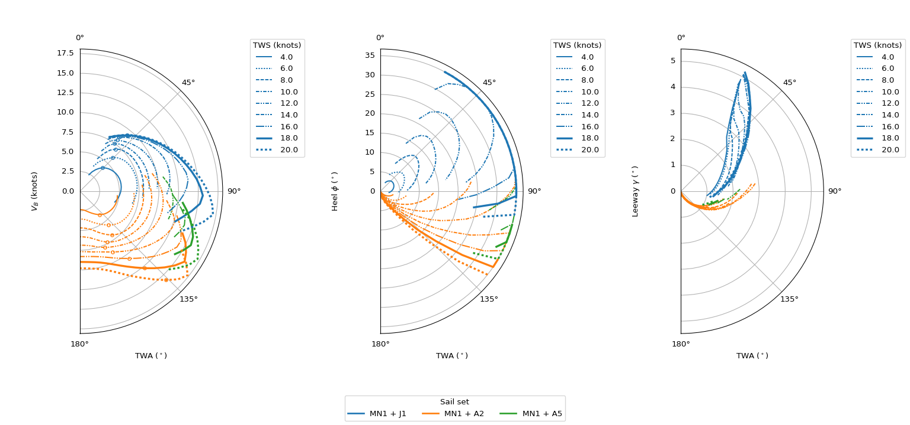

# Python-VPP

3-DOF Velocity Prediction Program based on the [ORC](https://www.orc.org/index.asp?id=21) aero and hydro dynamic models. 

Please see the demo hosted at [https://yacht-vpp.streamlit.app/](https://yacht-vpp.streamlit.app/) and go for a test sail!

## Installation

Python-VPP is on PyPI and needs Python 3.11 or newer:

```bash
pip install python-vpp
```

Then build a yacht and run the VPP:

```python
import numpy as np
from python_vpp import VPP, Yacht, Keel, Rudder, Main, Jib, Kite

yacht = Yacht(
    Name="YD41", Lwl=11.90, Vol=6.05, Bwl=3.18, Tc=0.4, WSA=28.20, Tmax=2.30,
    Amax=1.051, Mass=6500, Ff=1.5, Fa=1.5, Boa=4.2, Loa=12.5,
    App=[Keel(Cu=1.00, Cl=0.78, Span=1.90), Rudder(Cu=0.48, Cl=0.22, Span=1.15)],
    Sails=[
        Main("MN1", P=16.60, E=5.60, Roach=0.1, BAD=1.0),
        Jib("J1", I=16.20, J=5.10, LPG=5.40, HBI=1.8),
        Kite("A2", area=150.0, vce=9.55),
    ],
)
vpp = VPP(Yacht=yacht)
vpp.set_analysis(tws_range=np.arange(4.0, 22.0, 2.0), twa_range=np.linspace(30.0, 180.0, 31))
vpp.run()
vpp.polar(n=3, save=True)  # Polars.pdf
vpp.write_csv("polar.csv")  # best boat speed, TWA rows x TWS columns
```

The righting arm curve is passed with `Yacht(..., GZ={"Heel": [...], "GZ": [...]})`. Without it, `righting_moment.json` is read from the working directory, falling back to the YD-41 curve shipped with the package. The ORC sail and resistance coefficients are part of the package.

## Using the code

The project is managed with [uv](https://docs.astral.sh/uv/). Install it once (see the [uv docs](https://docs.astral.sh/uv/getting-started/installation/) for other methods):

```bash
curl -LsSf https://astral.sh/uv/install.sh | sh
```

Then clone the repository and install the dependencies into a local `.venv`:

```bash
git clone https://github.com/marinlauber/Python-VPP.git
cd Python-VPP
uv sync
```

From a clone of the repository, the main files that are used are `runVPP.py` and `righting_moment.json`. These have to be filled with the data of your boat. By default they are using the YD-41 (from Principle of Yacht Design). The code lives in `src/python_vpp/`, with the model coefficient data in `src/python_vpp/dat/`; `uv sync` installs it in editable mode.

The VPP is run from the root of the repository with

```bash
uv run python runVPP.py
```

At each TWS/TWA the boat speed is maximised over boat speed, heel, leeway, sail flattening and reefing, subject to force and moment equilibrium (SLSQP). `VPP.set_analysis` takes an optional maximum heel angle (`phi_max`, default 35 degrees); the sails are only flattened (down to flat = 0.53) and reefed as much as is fastest within it, following the ORC VPP 2026 depowering scheme. Kites are further limited to their own `max_heel` (default 21.5 degrees, the ORC limit under spinnaker). Points where a sail set cannot be carried within its heel limit are left at 0 and not plotted. The apparent wind follows the ORC heeled wind triangle: TWS is taken at 10 m and scaled to the sail plan's centre of effort with a log wind profile (z0 = 0.005 m), and its cross-track component is reduced by cos(heel). Appendage drag follows the ORC strip friction, form factor and lift-dependent drag, and the induced drag the ORC rudder ramp (zero lift upright), heel multiplier and free-surface/funsteady span corrections. Appendage lift uses the geometric aspect ratio span²/area, doubled for the reflection in the hull, in a lifting-line lift-curve slope (Jones slender-wing slope for short keels). `VPP.run` accepts `method="sequential"` (default) or `"parallel"` (same results, spread over all CPU cores).

To run the Streamlit demo locally:

```bash
uv sync --extra demo --extra api
uv run streamlit run demos/Home.py
```

The run writes the results to `results.json`, the best boat speed to `polar.csv` (TWA rows, TWS columns, `;` separated, for routing software such as OpenCPN; `tws_range`/`twa_range` interpolate it onto another grid, e.g. the 5° / 2 kn steps OpenCPN expects) and saves the polars (`Polars.pdf`) and the sail chart (`SailChart.pdf`) as PDF, so the curves stay sharp when zoomed. For the YD-41 the polars look like this (`Figure.png` is a PNG copy of `Polars.pdf` for this page)

<p align="center">
    
</p>

See the [documentation](https://marinlauber.github.io/Python-VPP/).

### Input variables

Here is a list of the key variables used in the VPP.

1. Appendages :
    * Cu : Root Chord / Upper Chord (m)
    * Cl : Tip Chord / Lower Chord (m)
    * Span : Span (m)
    * Tc_ratio : thickness/chord ratio for the ORC form factor (keel 0.20, rudder 0.10 by default)
1. Yacht :
    * Lwl : Length waterline (m)
    * Vol : Displ. volume of canoebody (m^3)
    * Bwl : Beam waterline (m)
    * Tc : Canoe body draft (m)
    * WSA : Wetted surface area (m^2)
    * Tmax : Draft max, i.e. Keel (m)
    * Amax : Max. section area (m^2)
    * Mass : Total mass of the yacht, including keel (kg)
    * Ff : Freeboard height fore (m)
    * Fa : Freeboard height aft (m)
    * Boa : Beam overall (m)
    * Loa : Length overall (m)
    * App : List of appendages
    * Sails : List of Sails
1. Sails:
    Standard measurements, except Roach is defined as 1-A/(0.5PE)
    HBI (jib) is the height of the base of I above the waterline; sail centres of effort (kite vce) are measured from it
    Kite only takes area and vce estimate (this is very rough), min_reef (default 0.85) for depowering and max_heel (default 21.5 degrees)
1. VPP.set_analysis()
    * TWA range : range of TWA to use
    * TWS range : range of TWS, must be between [2, 35]

## Contributing

We are very keen to see contributions to code, documentation and feature development!

When you make a contribution please make sure that any new functionality is covered with additional tests.

Follow the steps below to contribute to this project.

### Install dependencies

Install the project with the development tools (pytest, ruff, mypy) and the API dependencies:

```bash
uv sync --extra dev --extra api
```

Note that `uv sync` removes extras that are not listed, so pass every extra you need (or use `uv sync --all-extras`).

If using `pip` instead:

```bash
pip install -e ".[dev,api]"
```

### Run tests

Tests are implemented using [pytest](https://docs.pytest.org/en/8.0.x/).

You can run tests with

```bash
uv run pytest -vv
```

### Release

Bump `version` in `pyproject.toml`, then create a GitHub release with a matching tag (e.g. `v1.0.0`). The `python-publish.yml` workflow builds the package with `uv build` and uploads it to PyPI through trusted publishing. Check the build locally first with `uv build`.

You can run a benchmark against the YD-41 results from WinVPP by running the `benchmark.py` script (`-g` saves the polars as one `Figure_<label>_<TWS>.pdf` per wind speed plus a `Figure_<label>_stats.pdf` error summary, `-s` saves the results).

```bash
uv run python benchmark/benchmark.py -g -s
```

## Acknowledgements

* **[Otto Villani](https://www.linkedin.com/in/otto-villani-552760108/)** - *Initial idea, model selection* - [GitHub](https://github.com/ottovillani)
* **[Marin Lauber](https://www.linkedin.com/in/marin-lauber/)** - *Initial idea, development* - [GitHub](https://github.com/marinlauber)
* **[Thomas Dickson](https://tajd.co.uk/about)** - *Developer* - [GitHub](http://github.com/TAJD)

## License

This project is licensed under the MIT License - see the [LICENSE](LICENSE) file for details
